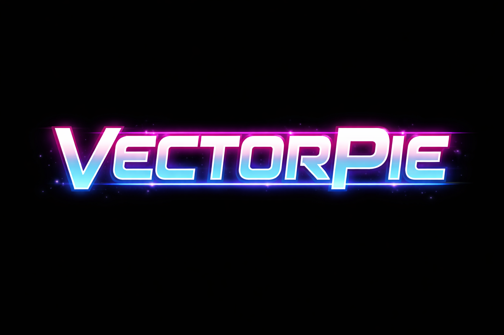

# VectorPie User Manual



## Overview

VectorPie is a Raspberry Pi image for the BeamForge and USB-DVG vector generator boards. It boots straight into a game menu driven entirely from the arcade controls — no keyboard, mouse, or desktop. It also works without a vector board, on an HDMI monitor.

- **Headless** — runs at boot, no monitor or desktop needed on the Pi
- **Marquee display** — the HDMI output shows the artwork for the highlighted game
- **BeamForge and USB-DVG** — drive a real vector monitor; HDMI works without them. BeamForge is the much faster board: about 20 million points a second
- **One input mapping** — configured once in AdvanceMAME, used by the menu and every game
- **High scores** — read from the MAME save files and shown in the hint bar
- **App store** — games made with the VectorPie SDK install from the menu: online from the VectorPie app store, from a USB drive or over the network
- **LED lighting** — each game lights its own controls in its own colors, with a voice-guided tour and beat-synced light shows
- **Background music** — a theme or your own playlist while you browse, with DJ breaks between tracks
- **Screensavers** — the built-in one, or screensaver apps from the app store that react to the music
- **Wi-Fi** — set up from the menu
- **Remote access** — SSH and a Windows network share
- **Updates from the menu** — with automatic rollback if the new version fails to boot

Runs on the **Raspberry Pi 4** and **Raspberry Pi 5**.

---

## Supported Hardware

VectorPie runs on a Raspberry Pi. To play on a real vector monitor, the Pi connects to it through a vector board: BeamForge or USB-DVG. Without one, the menu and games show on an HDMI monitor.

- Raspberry Pi 4 or 5, 1 GB or more. Raspberry Pi 5 recommended for better performance.
- **An SSD, strongly recommended:** on a Pi 5, an M.2 NVMe SSD on an M.2 NVMe HAT. An SSD is much more reliable than an SD card for a cabinet that runs for hours every day, and faster too. Choose a drive known to work with the Raspberry Pi 5: not every NVMe SSD does.
- Or a 32 GB SD card or larger.

Installation guides:

- [BeamForge](docs/beamforge-installation.md)
- [Space Duel adapter board](docs/space-duel-adapter-installation.md)
- [Asteroids adapter board](docs/asteroids-adapter-installation.md)

---

## Download & Installation

VectorPie comes as one image file: write it to an SSD (recommended) or an SD card, put it in the Pi, and the cabinet boots into the game menu. After that, VectorPie and the vector board's firmware are updated from the menu, with no reflashing.

### VectorPie Image

1. Download the image (about 2 GB): ([VectorPie Image](https://drive.google.com/file/d/1MTDPK5mUQjhhaaRrVNwTPDbsvIzAS67E/view?usp=sharing))
2. Write it to the SSD (connected to your PC with a USB adapter) or to the SD card with **balenaEtcher** ([download](https://etcher.balena.io/)): **Flash from file** → the `.img.gz` → **Select target** → **Flash!**
3. Install the SSD or insert the SD card, and power on. VectorPie boots into the game menu.

### Firmware

Both boards are updated from the menu: **Settings → DVG → UPDATE...** (see [Firmware updates](#firmware-updates)).

**BeamForge** has one firmware for every board.

**USB-DVG** has two variants:

- **Standalone** — any cabinet or custom controls
- **Arcade Control** — for the adapter card that connects to the original harness of an Asteroids, Asteroids Deluxe, Space Duel, Tempest, or Black Widow cabinet, so its buttons, CRT and coin inputs work natively

| USB-DVG Version | Use |
|---|---|
| v1 / v2 | Standalone only |
| v3 or later (standalone) | Standalone |
| v3 or later (on adapter card) | Arcade Control |

---

## Menu Navigation

The whole cabinet is used from its arcade controls: browse the games, launch one, change the music, open the settings. A keyboard works too. The controls are the ones mapped in AdvanceMAME. The hint bar at the bottom scrolls the available controls and the selected game's high scores.

> A keyboard may be needed once, to map the arcade controls inside AdvanceMAME.

| Action | Description |
|---|---|
| Up / Down | Move between games |
| Left / Right (on manufacturer header) | Previous / next manufacturer |
| Left / Right (on a game) | Cycle ROM variants (revisions, regions, prototypes) |
| Select (tap) | Launch the game |
| Select (hold ~1 s) | CONTROL GUIDE: each of the game's controls blinks alone on the panel while a voice names it. Ends with INSERT COIN and PRESS START; any input stops it. Needs a configured LED panel — without one, holding just launches |
| Player 2 Start | Next music track |
| Settings | Open the settings menu |
| Quit | Reboot (Select confirms) |

---

## Menu Layout

The menu groups the games by manufacturer, the way an arcade collection is usually sorted. Revisions of the same game (regions, prototypes) are grouped under one entry, so the list stays short:

- The **manufacturer header** is the top entry; Left/Right on it switches manufacturer.
- **Games** are listed below it. A game with several ROM variants shows arrows; Left/Right cycles them.
- The **selected item** is full-size in the center with a pulsing highlight; the others shrink toward the edges. Long names scroll.

---

## Marquee Display

An HDMI screen in the marquee area of the cabinet becomes a live marquee. The HDMI output shows the highlighted game's marquee, or the manufacturer's logo on a header. A game without artwork gets a default image. Scaling (Fit, Stretch, Zoom) is set in Settings → DISPLAY. When a game has a preview video, it plays over the marquee when you land on it.

---

## Input Mapping

You set up your controls once, and they work everywhere. Controls are mapped **once, in AdvanceMAME**, and used everywhere: the menu, every AdvanceMAME game, and the games built natively for the Pi. To remap, launch any AdvanceMAME game and use its input configuration menu; the change applies on the next launch.

> With a vector board (BeamForge or USB-DVG), AdvanceMAME's in-game menus — including input configuration — are mirrored on the vector display, so you can rebind while watching the monitor. Bindings show there in short form (`J:BTN1`, `LCTRL`, `P:1` = keypad 1); HDMI shows the full names.

### Rebinding from the menu

**Settings → CONTROLS → CONFIGURE INPUTS...** rebinds the common controls without a keyboard or a game: UI CONFIG and UI CANCEL first, then the player controls (P1/P2 directions, fire, start, coin, pause), each with its binding.

- Highlight a control, press **Select**, then press the key, button, or stick direction. The binding builds up live (`p` then `6` gives `p or 6`).
- Press several inputs for "or" alternatives.
- Press **Cancel** to finish the capture (**Escape** when rebinding Cancel itself). A capture left alone finishes after 20 seconds.
- **Left / Right** resets a control to its default.
- UI CANCEL always keeps Escape and UI CONFIG always keeps Tab, so you can't lock yourself out.

Nothing is written until **SAVE AND EXIT**; leaving with unsaved changes asks first. The bindings go to the AdvanceMAME configuration, so they apply everywhere.

The menu reads these actions:

| AdvanceMAME Action | Menu Function | Default Key |
|---|---|---|
| `ui_up` | Up | Up Arrow |
| `ui_down` | Down | Down Arrow |
| `ui_left` | Left / previous manufacturer | Left Arrow |
| `ui_right` | Right / next manufacturer | Right Arrow |
| `ui_select` | Launch | 1, Enter, or Left Ctrl |
| `ui_configure` | Settings | Tab |
| `ui_cancel` | Quit / exit | Escape |
| `p2_start` | Next track | 2 |

### Game Controls

AdvanceMAME maps the connected hardware to each game's control types:

| Control Type | AdvanceMAME Action | Typical Input |
|---|---|---|
| Directional movement | `p1_up/down/left/right` | Joystick, arrows |
| Twin-stick aim | `p2_up/down/left/right` | Second joystick, R/F/D/G |
| Fire / action | `p1_button1` | Left Ctrl, mouse button, joystick button |
| Player 1 start | `start1` | 1 |
| Insert coin | `coin1` | 5 |

> A mouse and an analog joystick can both be connected. For analog-stick games (Star Wars, Empire Strikes Back, Lunar Lander, Tail Gunner, Red Baron), **CONTROLS → ADSTICK** picks which drives the control — JOYSTICK or MOUSE. Spinners and trackballs are unaffected.

---

## LED Lighting

VectorPie can control the LEDs of your control panel's buttons and joysticks:

- **Show the controls each game uses.** When you pick a game, only its buttons and joysticks light up, each in that game's own color. The launch button blinks to show what starts the game.
- **Tell you what each control does.** Hold the launch button and a voice guide tours the panel: each control lights in turn while a voice says what it does (FIRE, THRUST, SHIELD...).
- **Animate the panel.** Light shows play when the menu starts, when a game launches and while you browse a manufacturer.
- **Dance to the music.** During the screensaver, the panel animates on the beat of the music.

Supported boards: **PacLED64**, **NanoLed**, **PacDrive** and **I-PAC Ultimate I/O**, several at once if needed. Setup is done once, from the menu on the cabinet (Settings → LEDS).

### Connecting the board

1. Wire each lamp to the board. An RGB lamp uses three consecutive outputs, n, n+1, n+2. On an Ultimate I/O the connectors from output 49 up are rotated, so their pins run B, G, R; plug the lamp in pin for pin on either side and the menu sorts the colors out. (The PacLED64 is R, G, B throughout.)
2. Plug the board into a USB 2.0 port (black; the blue ones are for the vector board).
3. The board is detected automatically and LED SETUP lists it. No drivers, no service.

### Configuring each output

**Settings → LEDS → LED SETUP** is one page. BOARD picks the board, OUTPUT walks its outputs — the one you land on lights on the panel. Per output:

- **MODE** — MONO or RGB. RGB takes the next two outputs, so it is offered only on a trio boundary (1, 4, 7…), and not on a PacDrive (on/off outputs). A MONO lamp on a board with levels shows any color as an intensity (0.3 R + 0.6 G + 0.1 B): red dim, green medium, white full.
- **LED STRIP SIZE** — NanoLed only: the number of LEDs in the strip or ring under the control (a spinner ring). The strip is one lamp, lit one LED after another.
- **BRIGHTNESS** — dims a lamp that outshines the others. Not offered on an on/off board.
- **TYPE** — what the control is:
  - **BUTTON, JOYSTICK, SPINNER, TRACKBALL** — game controls: lit per game, colored by the game, named by the guide
  - **COIN** — lit while a game is selected
  - **START** — driven by the running game (Space Duel lights its own)
  - **OTHER** — a cabinet lamp no game uses (a menu button); steady while the menu is up
- **INPUT** — press the control the lamp sits over. A joystick has one lamp and several inputs: press all its directions. SPINNER and TRACKBALL fill in their axis by themselves; turn the control to override it.

Nothing is written until **SAVE AND EXIT**; leaving with unsaved changes asks first. **CLEAR CONFIG** wipes the board's outputs and colors (press twice). A board that is configured but not connected shows in red; clearing it is all that page offers.

### Cabinet colors

**CABINET COLORS** colors the lamps no game owns — coins, starts, the menu button. OUTPUT picks the lamp (it lights alone); TYPE says what it is to the cabinet (coin1, start1, the menu button, other). The color follows that, so it survives rewiring. Default is red for all. Starts light only when the game drives them. **RESET TO DEFAULT** restores the defaults (press twice).

### Game colors

**GAME COLORS** recolors one game's controls — fire red, thrust white — for every revision of the title, however the panel is wired. Every game ships with colors and a voice tour. OUTPUT picks the lamp (it lights alone, in its color); TYPE is its wiring type, ROLE what it does in that game (fire, rotate…); **RESET TO DEFAULT** restores the shipped look (press twice).

Every color picker offers the same twelve colors, plus black for off.

### Light shows

**LED SHOW** animates the whole panel. **ANIMATION** picks one of four:

| Animation | Plays |
|---|---|
| **SCREENSAVER** | during the screensaver — on the beat of the music, or on a fixed interval |
| **STARTUP** | once, as the menu comes up |
| **LAUNCH** | once, as a game starts |
| **MANUFACTURER** | looping while the cursor is on a manufacturer |

An animation is a list of frames; a frame is which lamps are lit, in what color. **FRAMES** sets how many (up to 32), **INTERVAL** how long each is held. The screensaver animation also has a **MODE**: **BEAT** steps one frame per beat of the music (see [Beat maps](#beat-maps)), **INTERVAL** steps on the clock.

**EDIT FRAMES...** builds the frames lamp by lamp, with the panel showing the frame as you go. Pick the **FRAME** and its **EFFECT** — hold, strobe, fade in, fade out, or random — then:

- **LAMP** walks every lamp on the cabinet by address; while the cursor is on LAMP or COLOR the picked lamp shows at full on the panel (blinking white if it isn't lit) with the frame's other lamps dimmed to a twentieth, and `*` marks the ones already in the frame. Select puts it in, in **COLOR**, or takes it out. The other rows show the whole frame.
- **COLOR** is the twelve colors and **RANDOM** (a fresh color each time the frame plays). Changing it recolors the picked lamp; on a PacDrive lamp it just reads **ON**.
- **CLEAR FRAME** turns every lamp off.

Nothing is written until **SAVE AND EXIT**; leaving with unsaved changes asks first. **CLEAR ANIMATION** deletes every frame (press twice).

---

## Wi-Fi Configuration

VectorPie connects to Wi-Fi from the menu, with the arcade controls; no keyboard needed. A network connection gives you the app store, software and firmware updates, and access to the Pi from a PC. A network cable works without any setup.

1. Open Settings and go to **NETWORK** — networks are scanned in the background
2. Left/Right on **WIFI NETWORK** picks yours
3. Select on **WIFI PASSWORD** to edit: **Up/Down** cycles the character under the cursor (the last choice, **DEL**, deletes it), **Left/Right** moves along (Right past the end adds a character), **Select** confirms it, **Cancel** saves
4. Select **CONNECT**

Connection status and IP address are shown at the top of the section.

---

## Background Music

VectorPie turns your cabinet into a jukebox. Your own music plays while you browse the games, with DJ breaks between tracks like a radio station, and steps aside while you play. When the cabinet sits idle, the LED panel and the screensaver move to the beat.

**Settings → MUSIC → TYPE** picks the mode:

- **THEME** — one looping track from the themes directory, chosen with **MUSIC → THEME**; it previews as you cycle.
- **PLAYLIST** — every track in the playlist directory, in alphabetical or shuffled order (**PLAYLIST SHUFFLE**). The next track starts when one ends, even with Settings open.

A launched game pauses the playlist; it resumes where it was when the game exits. The current and next titles show on the screensaver.

**Player 2 Start skips to the next track** — in the menu (and starts the screensaver), and during the screensaver without waking it. A DJ break can't be skipped.

### Beat maps

The screensaver light show follows the beat once each track has a **beat map**. **Settings → MUSIC → GENERATE BEAT MAPS...** makes them, about half a minute per track; **Cancel** stops it and a later run picks up where it left off. A track without a map gets the breathing show.

A map is a `.beats` file beside its track. Importing from USB copies any already on the drive.

### Importing from USB

**Settings → MUSIC → IMPORT ⏏** copies `.mp3` / `.ogg` tracks from a drive's `playlist/` folder into the playlist, its `themes/` folder into the themes, and its `radio/` folder (DJ announcements) into `/persistent/vector_pie_menu_dir/radio`; a missing folder is skipped. Left/Right picks **ADD** (keep what's there, add the rest) or **REPLACE** (empty the destination first). REPLACE asks for a second press.

Prepare the drive:

1. Format it FAT32, exFAT, or NTFS
2. Create `playlist/`, `themes/`, and/or `radio/` at the root
3. Copy the `.mp3` / `.ogg` files in; files elsewhere are ignored
4. Plug it in and run the import

The drive can carry a `vectorpie_backup.tar.gz` too. The row reports `ADDED 23/4` (playlist / themes, plus `+2 DJ` when radio clips came over), `NO playlist/ themes/ OR radio/`, or `NO TRACKS ON USB`.

| File type | Location |
|---|---|
| Theme tracks | `/usr/local/share/advance/themes` |
| Playlist tracks | `/persistent/vector_pie_menu_dir/playlist` |

---

## Idle Dimming & Screensaver

When nobody plays, the cabinet takes care of itself: the menu fades out of the way, then a screensaver starts, protects the tube, and keeps the music and lights going. Any control brings the menu back.

| Timeout | Behavior |
|---|---|
| Stop pressing keys | Menu text fades over the MENU FADE time (default 2.5 s); the marquee brightens; hints disappear |
| 60 seconds idle | Screensaver: a short attract video, then the screensaver video loops |

The HDMI screensaver shows the current and next track titles, and that Player 2 Start skips. The vector board (BeamForge or USB-DVG) shows drifting asteroids and a bouncing VectorPie logo. With an LED panel, the SCREENSAVER light show plays (see [Light shows](#light-shows)). Any control other than Player 2 Start returns to the menu.

### Screensaver apps

Screensaver apps replace the built-in screensaver on the vector monitor. They react to the music: Spectrum shows it as a spectrum analyzer that bumps on every beat, Pulse as a star of the spectrum with rings on every beat, VU Meters on two analog meters, left and right. The music, DJ breaks and light show go on as usual, and HDMI shows the app's marquee.

- **Settings → SCREENSAVERS → INSTALL...** installs them, online from the app store or from a USB drive, like games (see [Game Packages](#game-packages)). **REMOVE...** removes one.
- **SCREENSAVERS → SELECT** picks the screensaver: **VECTORPIE** (the built-in one), an installed app, or **RANDOM** (a different one each time).

---

## Settings Menu

Everything in VectorPie is set from one Settings menu, with the arcade controls: games and screensavers, backups, updates, the vector board, controls, sound, display, music, LEDs and network. **Tab** opens Settings; Tab or **Escape** closes it. Up/Down moves, Left/Right adjusts, Select toggles or opens. With a vector board (BeamForge or USB-DVG), Settings is mirrored on the vector display.

Sections: GAMES, SCREENSAVERS, BACKUP, SYSTEM, DVG, CONTROLS, AUDIO, DISPLAY, MUSIC, EFFECTS, LEDS, NETWORK.

| Section | Setting | Description |
|---|---|---|
| GAMES    | INSTALL GAMES... | Install or update game packages, from a USB drive, the network or online. See [Game Packages](#game-packages). |
| GAMES    | REMOVE GAME... | Remove an installed game, keeping its high scores or not. |
| SCREENSAVERS | INSTALL...  | Install or update screensaver apps. See [Screensaver apps](#screensaver-apps). |
| SCREENSAVERS | REMOVE...   | Remove an installed screensaver app. |
| SCREENSAVERS | SELECT      | The screensaver: VECTORPIE (built-in), an installed app, or RANDOM. |
| BACKUP   | SAVE ⏏         | Save settings to a USB drive. See [Backup Save / Restore](#backup-save--restore). |
| BACKUP   | RESTORE ⏏      | Restore them from the drive. |
| SYSTEM   | VECTORPIE UPDATE... | The update page: checks online, shows the release notes, UPDATE applies. See [Software Updates](#software-updates). |
| SYSTEM   | EXIT TO SHELL  | Leave the menu for a Linux prompt |
| DVG      | DVG            | Vector board output on/off |
| DVG      | HARDWARE       | The connected board: BEAMFORGE or USB-DVG. OTHER is an unrecognized board: it gets no firmware updates. |
| DVG      | DVG REFRESH    | Refresh rate, 30–60 Hz. Default 40. Applies as you adjust — raise for a steadier, brighter picture, lower if the display can't keep up. |
| DVG      | FIRMWARE VARIANT | USB-DVG only: firmware variant on the board, STANDARD or ARCADE CONTROL (BeamForge has none). Used by UPDATE... (below). Newer firmware reports it and this follows. |
| DVG      | UPDATE...      | The firmware update page (for the FIRMWARE VARIANT): checks online, shows the release notes, UPDATE flashes. |
| DVG      | SETTINGS...    | The board's own settings menu on the vector display: Up/Down/Left/Right navigate, Select confirms, Cancel goes back (at the top level, closes and saves), Config closes and saves from anywhere. Closes by itself after 30 s without a press. Needs firmware 1.14R2 or later. |
| DVG      | CRT CALIBRATION | Alignment patterns on the vector display: Left/Right cycles them, Cancel exits. |
| DVG      | OVERLAY        | Color overlays: DISABLED / COLORING / ARTWORK / BOTH (see below) |
| DVG      | AUTOSTART GAME | Launch the board's default game at startup |
| CONTROLS | ZERO DEADZONE  | Removes the joystick deadzone at the kernel level. Needed by some analog controllers (Alan-1 Star Wars yoke). |
| CONTROLS | ADSTICK        | Which device drives analog-stick games: JOYSTICK or MOUSE. |
| CONTROLS | CALIBRATE      | Left/Right picks the joystick, Select opens its calibration page. Move all axes to their extremes, let go, press Select — the resting position becomes center. Reapplied at every startup. Grayed with no joystick. |
| CONTROLS | CONFIGURE INPUTS... | Rebind the AdvanceMAME controls from the menu. See [Rebinding from the menu](#rebinding-from-the-menu). |
| AUDIO    | OUTPUT         | The audio device in use: `USB`, `HEADPHONE`, `SOUND HAT`, or `DEFAULT` |
| AUDIO    | MASTER VOLUME  | System volume |
| AUDIO    | MAME SOUND QUALITY | AdvanceMAME audio: **HIGH** (48 kHz), **MEDIUM** (22 kHz, smoother on demanding games), **LOW** (11 kHz, maximum performance; speech games sound muffled) |
| DISPLAY  | MARQUEE        | Marquee scaling: FIT / STRETCH / ZOOM / FIT WIDTH / FIT HEIGHT |
| DISPLAY  | MENU ON HDMI   | With a vector board (BeamForge or USB-DVG), also show the game menu on HDMI. Off: HDMI shows only the marquee (and hint bar). |
| DISPLAY  | SHOW GAME PREVIEW | Play a game's preview video (`/usr/local/share/advance/video/<rom>.mp4`) over the marquee when you land on it. Default on. |
| DISPLAY  | MENU FADE      | Fade-out time for the menu text: 1.0–15.0 s. Default 2.5 s. |
| DISPLAY  | HINTS          | Control hints in the hint bar |
| DISPLAY  | HIGH SCORES    | High scores in the hint bar |
| MUSIC    | VOLUME         | Music volume |
| MUSIC    | TYPE           | **THEME** or **PLAYLIST** |
| MUSIC    | THEME          | The looping theme track; previews as you cycle. Grayed with PLAYLIST. |
| MUSIC    | PLAYLIST SHUFFLE | Random or alphabetical order. Grayed with THEME. |
| MUSIC    | IMPORT ⏏       | Copy tracks from a USB drive — `playlist/`, `themes/`, and `radio/` folders. Left/Right: **ADD** or **REPLACE**; REPLACE asks twice. |
| MUSIC    | GENERATE BEAT MAPS... | Make the beat maps the screensaver light show follows. Cancel stops and keeps what's done. See [Beat maps](#beat-maps). |
| EFFECTS  | ENABLED        | Navigation and select sounds |
| EFFECTS  | VOLUME         | Their volume |
| LEDS     | LED SETUP      | Wire the LED panel. See [LED Lighting](#led-lighting). |
| LEDS     | CABINET COLORS | Colors for the coin, start and menu lamps. See [Cabinet colors](#cabinet-colors). |
| LEDS     | GAME COLORS    | Recolor a game's controls. See [Game colors](#game-colors). |
| LEDS     | LED SHOW...    | Light shows for the screensaver, startup, game launch and manufacturers. See [Light shows](#light-shows). |
| NETWORK  | ETHERNET       | Wired interface on/off. Off forces Wi-Fi even with a cable in. |
| NETWORK  | WIFI           | Wi-Fi radio on/off. |
| NETWORK  | HOSTNAME       | The Pi's name on the network, edited like the Wi-Fi password (lowercase, digits, hyphens). Applies live, including the `.local` name. |
| NETWORK  | CONNECTION     | Current connection and SSID |
| NETWORK  | IP ADDRESS     | Current IP address |
| NETWORK  | WIFI NETWORK   | Pick a network from the scan. |
| NETWORK  | WIFI PASSWORD  | Its password. See [Wi-Fi Configuration](#wi-fi-configuration). |
| NETWORK  | CONNECT        | Connect. Grayed when already on that network. |

Changes are saved when Settings closes.

---

## Backup Save / Restore

VectorPie can save your whole setup to a USB drive: controls, settings, game list, LED panel, high scores, Wi-Fi and more. Restore it on a fresh image, and everything is back as it was. Reflashing the SSD or SD card loses your settings, so save them first.

### What is backed up

- **advmame.rc** — input mappings, DVG and audio settings
- **vector_pie_menu.cfg** — menu preferences
- **gamelist.ini** — your game list
- **LED settings** — panel wiring, cabinet colors, game colors, light shows
- **Theme tracks** you've added
- **High scores** — `.hi` and NVRAM files, and those of installed game packages
- **Wi-Fi connections**
- **Hostname** — reapplied live, so the `.local` and share names carry over
- **SSH host keys** — so SSH clients don't complain after reflashing
- **Pi user password**
- **`/boot/firmware/user-config.txt`** — your boot overrides (included from `config.txt`, so it never conflicts with updates)
- **`/boot/firmware/cmdline.txt`** — the `video=` token only

### What is *not* backed up

Bulky content added over the network share. Copy it off the Pi separately if it must survive a reflash:

- **ROMs** — `/usr/local/share/advance/rom/`
- **Samples** — `/usr/local/share/advance/sample/`
- **Artwork** — marquees, manufacturer logos, overlays, under `/usr/local/share/advance/artwork/`
- **Game preview videos** — `/usr/local/share/advance/video/`
- **Playlist tracks and beat maps** — `/persistent/vector_pie_menu_dir/playlist/`, which survives updates in place but is not in the backup

Shipped ROMs, samples, and artwork are part of the image.

### How to use

**Save:** plug in a USB drive, **BACKUP → SAVE ⏏**. It writes `vectorpie_backup.tar.gz`.

**Restore:** boot the new image, plug in the drive, **BACKUP → RESTORE ⏏**.

Any mounted USB drive works. The row reports the result.

---

## Software Updates

VectorPie updates itself over the internet, from the menu, with no reflashing and no PC. It shows what's new before you update, keeps your settings, and goes back to the previous version by itself if the new one fails to start. The vector board's firmware is updated the same way.

### How to update

1. Connect to a network (see [Wi-Fi Configuration](#wi-fi-configuration))
2. **SYSTEM → VECTORPIE UPDATE...** opens the update page, which checks online: **CHECKING**, then **UP TO DATE (*version*)**, **UPDATE AVAILABLE: *version***, or **OFFLINE**, with the latest version's release notes in a box below it (Up/Down scroll, Left/Right a page). The cursor lands on **UPDATE** when there is one, else on **EXIT**
3. **UPDATE** applies (grayed when you already run that version): **DOWNLOADING → VERIFYING → APPLYING**, then the Pi reboots into the new version. **EXIT** or CANCEL returns to Settings

An update takes 10–15 minutes. Power loss during it is safe — the previous version stays until the new one boots — but let it finish.

### Firmware updates

**DVG → UPDATE...** works the same way for the board's firmware, BeamForge or USB-DVG (on a USB-DVG, for its FIRMWARE VARIANT): the page checks, shows the release notes, and UPDATE downloads, verifies and flashes. The page stays up through **DOWNLOADING → VERIFYING → FLASHING** (EXIT and Cancel wait until it is done); the vector display goes dark during the flash, then the Pi reboots. A failure shows on the page. Only newer firmware is offered, except that on a USB-DVG changing FIRMWARE VARIANT offers the other variant at the same version, so a board flashed with the wrong one can be corrected. A failed flash is recoverable: the board's bootloader is separate, so try again.

### What carries over

Everything a USB backup holds — see [What is backed up](#what-is-backed-up). The playlist carries over too: it lives on the persistent partition, untouched by updates.

### What does *not* carry over

User-added ROMs, samples, artwork, and preview videos — see [What is *not* backed up](#what-is-not-backed-up). **Copy them off the Pi before updating** and put them back afterward.

### If an update fails

VectorPie keeps two copies of itself. If the new one fails to boot, the Pi reverts to the previous on the next reboot. Retry later or skip the release.

---

## BeamForge and USB-DVG Support

With a vector board, VectorPie plays on a real vector monitor: the arcade games through AdvanceMAME, the app store games, and the menu itself. The vector board — BeamForge or USB-DVG — renders the menu as vector text on a real vector monitor, with manufacturer logos and an asteroids screensaver, alongside the marquee on HDMI. It is detected automatically and can be turned off in Settings. It can also name a default game to launch at startup.

BeamForge is the next-generation board: about 20 million points a second against the USB-DVG's 3 million. Games draw more on it, at higher frame rates.

> USB-DVG: firmware 1.14R0 or later is required.

### Connecting the board

Plug the BeamForge or USB-DVG into a **USB 3.0 port** (blue). Leave the other USB 3.0 port empty. On a **Pi 5**, a USB audio device goes in a USB 2.0 port (black). Joysticks, keyboards, mice and encoders go in the remaining USB 2.0 port, through a hub if needed.

### Color Overlays

Many black-and-white vector games shipped with a colored plastic overlay on the monitor. VectorPie tints the vectors instead:

| Game | Overlay |
|---|---|
| Armor Attack | Yellow border, green play field |
| Asteroids Deluxe | Blue |
| Barrier | Blue |
| Battle Zone | Green play field, red radar |
| Bradley Trainer | Green |
| Demon | Zone-based multi-color |
| Meteorites | Yellow |
| Omega Race | Amber |
| Red Baron | Cyan |
| Solar Quest | Red top, yellow center, blue elsewhere |
| Star Castle | Rings — blue outer, red, orange, yellow inner |
| Star Hawk | Blue at low intensity, white at high |
| Sundance | Yellow |
| Tail Gunner | Cyan |
| Warrior | Tinted |

Games with native color (Tempest, Major Havoc, Star Wars, Gravitar, Black Widow, Space Duel, Quantum, the Sega and Cinematronics color titles) use their own colors.

**Settings → OVERLAY**: DISABLED (all white), COLORING (tint only), ARTWORK (line artwork only), BOTH (default).

### Calibration Mode

**Settings → DVG → CRT CALIBRATION** puts test patterns on the vector monitor for geometry adjustment. Left/Right cycles them, Cancel exits. The pattern name shows on the marquee.

| Pattern | For |
|---|---|
| DIAGONAL BOXES | Linearity and geometry |
| CONCENTRIC BOXES | Centering and aspect ratio |
| GRID | Linearity and convergence |
| COLOR INTENSITY BARS | Beam intensity and color balance |

---

## Game Packages

Beyond the arcade classics, VectorPie installs new games made for the vector monitor, from the VectorPie app store, with a few presses. They show in the menu like any other game, with their marquee, high scores, LED colors and voice control guide, and the app store offers their updates.

Games made with the VectorPie SDK come as packages: one `.vpk` file per game. Screensaver apps install the same way (`.vps` files, see [Screensaver apps](#screensaver-apps)).

**Settings → GAMES → INSTALL...** installs them:

1. If a USB drive is plugged in, its `.vpk` files (in its `games/` folder or top folder) are copied to `/persistent/games/packages/`. The drive can be pulled out right after.
2. Packages of games already installed at the same or a newer version are deleted from that folder.
3. With a network connection, the games available online are listed too (see [vectorpie-games](https://github.com/Goldfinch2/vectorpie-games)). Offline, the page shows the folder's packages alone.
4. The page offers new games and updates of installed ones. **GAME** picks the game with Left/Right. Under it are its manufacturer, author, description, the installed version and the package's version (for an online game, **ONLINE** and its download size). On HDMI, the game's marquee shows beside them. Long values scroll on the vector monitor.
5. Select asks **INSTALL** (or **UPDATE**) with the game's name. **YES** installs it; an online game is downloaded first, its progress shown, and checked before it is installed. An update keeps the game's high scores. The `.vpk` is deleted once installed.

You can also copy `.vpk` files to `/persistent/games/packages/` yourself (network share or scp), no USB drive needed.

An installed game shows in the menu under its manufacturer, with its marquee and high scores, and launches like any other game. While it plays on the vector monitor, HDMI shows its marquee.

An installed game lights its controls in its own colors, and holding select on it in the menu plays its voice control guide, like any other game (see [LED Lighting](#led-lighting)).

**Settings → GAMES → REMOVE...** removes one: **GAME** picks it with Left/Right (its details and marquee show the same way), Select asks **REMOVE** with its name, and **YES** removes the game and its high scores.

Installed games live in `/persistent/games`, which updates don't touch. A USB backup also saves their high scores.

---

## High Scores

VectorPie shows each game's high scores right in the menu, so you know the score to beat before you play. The hint bar shows the selected game's high scores, read from its MAME `.hi` and `.nv` save files (or a game package's own high-score file): the label in gold, ranks and scores in cyan, names in white, alternating with the control hints in gray. Both can be turned off in Settings → DISPLAY.

---

## Launching Games

Launching a game is one press, and leaving it brings you right back to the menu. Select fades the music, hands over the display, and launches the game. When it exits the menu resumes, and a playlist track picks up where it was. Mappings or settings changed inside AdvanceMAME apply at once.

---

## Troubleshooting

**Don't read or write the SSD or SD card from a PC or Mac**

Even if the computer can mount the Pi's Linux partitions, don't. Files written with the wrong ownership can break the menu or game launches. Use the supported paths instead:

- **Network share** — `\\<pi-ip-address>\pi` (see [Accessing the Pi from a Windows PC](#accessing-the-pi-from-a-windows-pc))
- **SSH** — `ssh pi@<pi-ip-address>`
- **USB drive** — music through **MUSIC → IMPORT ⏏**, settings through **BACKUP → SAVE ⏏ / RESTORE ⏏**

---

**DVG, OVERLAY, AUTOSTART GAME and MENU ON HDMI are grayed out**

The vector board (BeamForge or USB-DVG) isn't detected. Check its USB connection.

---

**A mouse yoke and an analog joystick are both connected (Star Wars, ESB, Lunar Lander)**

Analog-stick games use the joystick by default. Set **CONTROLS → ADSTICK** to **MOUSE** to make the mouse drive them instead. Spinners, trackballs and everything else are unaffected.

---

**The Pi sometimes shows the Network Install screen instead of booting**

On Raspberry Pi OS Trixie Lite the red/white Network Install screen can appear at power-on even with a valid SSD or SD card. Disable it in the EEPROM:

```
sudo rpi-eeprom-config --edit
```

Add or set:

```
NET_INSTALL_ENABLED=0
```

Save and reboot.

---

## Appendix — Low-Level Access

Optional: normal use never needs a PC, a shell, or hand-edited files. This is for adding your own ROMs, artwork and music, and customizing the game list.

### Accessing the Pi from a Windows PC

VectorPie runs an SSH server and a Samba share. The Pi's IP address is in Settings → NETWORK.

| | |
|---|---|
| **Username** | `pi` |
| **Password** | `raspberry` |

#### Network Share (File Access)

In File Explorer's address bar type `\\<pi-ip-address>\pi` (e.g. `\\192.168.1.50\pi`) and log in. To keep it: right-click **This PC** → **Map network drive**, enter the path, check **Reconnect at sign-in**.

#### SSH (Command Line Access)

From Command Prompt or PowerShell: `ssh pi@<pi-ip-address>`, password `raspberry`. PuTTY works too.

### Game List — `gamelist.ini`

`/usr/local/share/advance/gamelist.ini`, one game per line, pipe-delimited:

```
MANUFACTURER|DISPLAY NAME|PARENT ROM|CLONE ROM[|COMMAND]
```

| Field | Description |
|---|---|
| MANUFACTURER | Groups games (`Atari`, `Sega`) |
| DISPLAY NAME | Shown in the menu |
| PARENT ROM | AdvanceMAME parent ROM |
| CLONE ROM | The variant to launch |
| COMMAND | Optional custom launcher for non-emulated games |

```
Atari|Asteroids (rev 2)|asteroid|asteroid
Atari|Tempest (rev 3)|tempest|tempest
Sega|Star Trek|startrek|startrek
```

Games sharing a parent ROM are variants, cycled with Left/Right. The menu sorts manufacturers and games alphabetically whatever the file order.

### Artwork, ROMs and Samples

| File type | Location |
|---|---|
| ROMs | `/usr/local/share/advance/rom` |
| Samples | `/usr/local/share/advance/sample` |
| Marquees | `/usr/local/share/advance/artwork/marquees` |
| Game preview videos | `/usr/local/share/advance/video` |

Artwork is PNG, named after the clone ROM (`asteroid.png`, case-insensitive), then the parent ROM, then `default.png`. Manufacturer logos are `mfg_<name>.png` (lowercase, underscores for spaces) in the marquees directory.

#### Per-resolution variants

Any image can have a variant per screen height: `<name>.<height>.png`. On a 1920×360 marquee panel `pacman.360.png` is used first, on a 1080p screen `pacman.1080.png`, otherwise `pacman.png`.

#### Vectrex per-cart marquees

Vectrex games load the cartridge named in the clone ROM field; the marquee is that name plus `.png` (`lunar.bin` → `lunar.bin.png`, case-insensitive), falling back to `default.png`.
