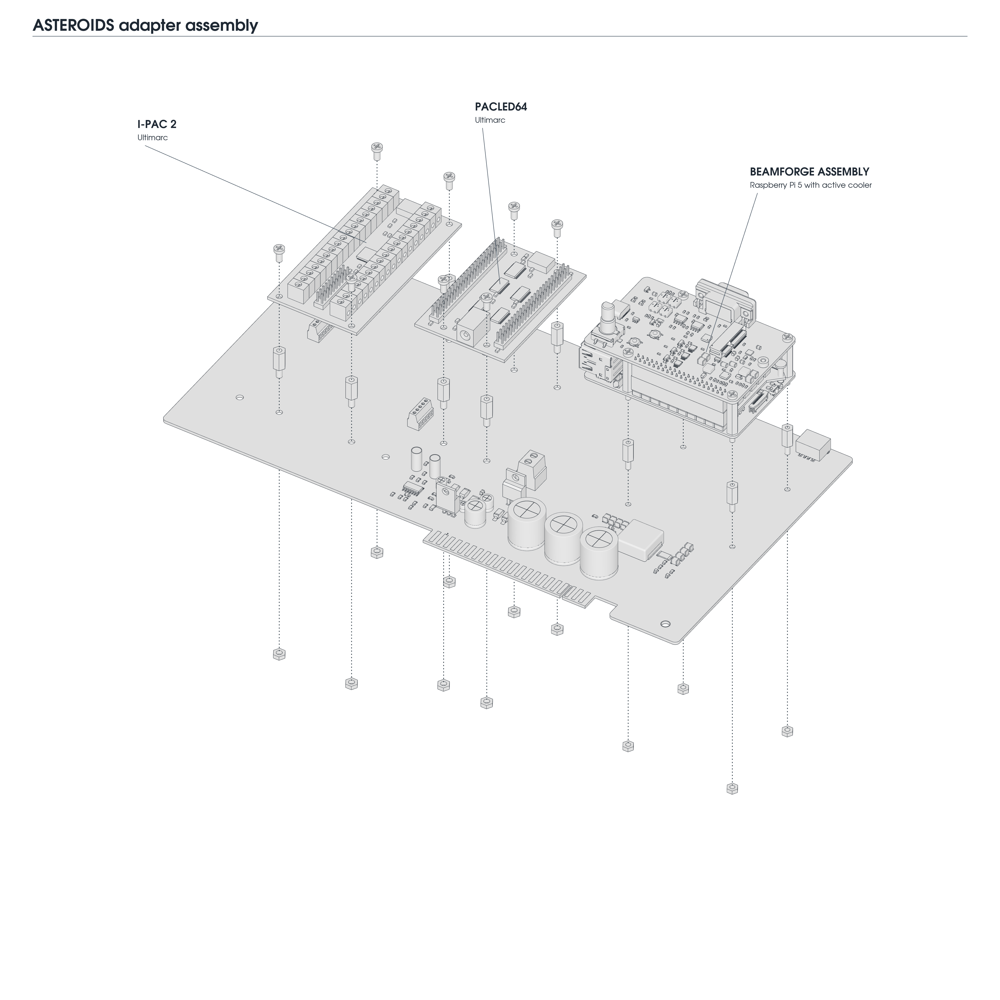
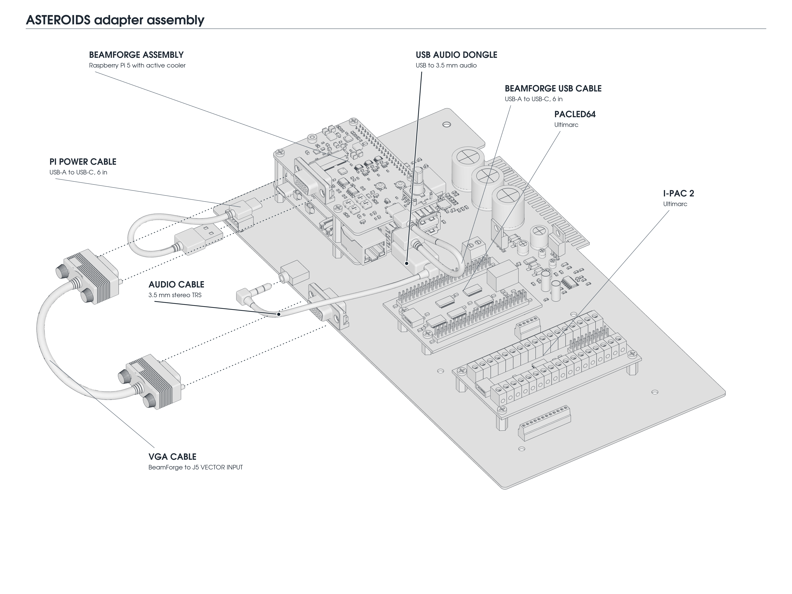

# Asteroids / Asteroids Deluxe Adapter Installation

This adapter connects VectorPie to an **Asteroids or Asteroids Deluxe cabinet** using its existing harness, vector monitor, and audio amplifier. It provides regulated **5.1 V** power for the Pi and a power connection for PACLED64.

The drawing above shows a **BeamForge assembly** — BeamForge above a Raspberry Pi 5 with active cooler — plus an **Ultimarc I-PAC2** for the original controls and an **Ultimarc PACLED64** for the original button LEDs. The two Ultimarc boards are optional if those cabinet functions are not needed or are handled separately.

## Included with the adapter

- Asteroids / Asteroids Deluxe adapter board.
- **4 × M2.5 male-female mounting spacers, 10 mm body**, for the Pi / BeamForge assembly.
- **VGA-style vector cable**: fully wired, straight-through male-to-male DE-15, approximately 6 in / 15 cm.
- **USB power cable**: USB-A to USB-C, approximately 6 in / 15 cm, from adapter J1 to the Pi's power socket.
- **Audio cable**: 3.5 mm stereo TRS male-to-male, from the audio source to adapter J3.

## Other installation parts

- [BeamForge assembly](beamforge-installation.md), with VectorPie installed on the Pi's storage. BeamForge includes the separate short **USB data cable** between the Pi and BeamForge.
- Optional Ultimarc I-PAC2 and PACLED64, with their USB cables and control/LED wiring.
- For Pi 5 audio: a Pi-compatible **USB audio dongle** with a 3.5 mm output, used with the included audio cable.
- If using PACLED64: a two-wire **5.5 × 2.1 mm DC barrel-plug lead** for LED power.

### Additional mounting hardware

The adapter includes the four 10 mm M2.5 spacers for the Pi / BeamForge assembly. **Spacers for I-PAC2 and PACLED64 are not included.** BeamForge includes its own 20 mm standoffs, screws, nuts, and GPIO extender.

| Module | Standoffs | Fasteners |
|---|---|---|
| Pi / BeamForge assembly | 4 × M2.5 male-female, **10 mm body** | Reuse the 4 × M2.5 nuts from under the Pi |
| I-PAC2, if fitted | 4 × M3 male-female, **10 mm body** | 4 × M3 × 6 mm screws; 4 × M3 nuts |
| PACLED64, if fitted | 4 × M3 male-female, **10 mm body** | 4 × M3 × 6 mm screws; 4 × M3 nuts |

Standoff body lengths exclude the threaded stud. For both Ultimarc boards, the total is **eight M3 standoffs, eight screws, and eight nuts**.

## Mount the boards

Turn off and unplug the cabinet before fitting boards or changing wiring. Leave the monitor's high-voltage connections alone; a CRT can retain dangerous voltages even when unplugged.

1. Build the Pi / BeamForge stack following the [BeamForge assembly instructions](beamforge-installation.md#assemble-beamforge-and-the-pi).
2. Remove the four nuts underneath the Pi. Screw the **female ends of the four 10 mm M2.5 standoffs** onto the exposed studs of the existing 20 mm standoffs. The Pi is held between the upper and lower standoffs.
3. Lower the assembly onto the adapter's **RASPBERRY PI** mounting pattern. Pass the lower standoffs' male studs through the adapter and secure them with the **four reused nuts underneath**.
4. Check that no component, solder joint, or loose wire touches a board above or below it. Keep the fan intake and cable access clear.
5. Secure the adapter in the cabinet and connect the original harness to its card edge, with the keying and component/solder sides correctly aligned. Support the assembly using the cabinet's board mounts; do not leave its weight hanging from the harness connector.

## Connect the cables

*Some plugs are pulled back in the drawing to show their sockets and insertion direction. Seat them fully in the finished assembly. The I-PAC2 and PACLED64 USB cables, terminal wiring, and PACLED64 power lead are omitted for clarity.*

**J1–J6 below refer to the adapter board.** With the Pi PCB horizontal, upper USB sockets are farther from the PCB; lower sockets are closer to it.

| From | To | Purpose |
|---|---|---|
| **J1 PI POWER USB-A** | Pi **USB-C power** socket | Regulated 5.1 V power |
| Pi **upper blue USB 3** socket | BeamForge **USB-C** | BeamForge data connection |
| BeamForge **15-pin vector output** | **J5 VECTOR INPUT** | X, Y, and monochrome intensity |
| Pi **lower blue USB 3** socket | USB audio dongle | Audio output |
| Dongle's **3.5 mm output** | **J3 AUDIO IN** | Audio to the cabinet amplifier |
| Pi **black USB 2** socket | I-PAC2 USB socket | Controls, if fitted |
| Other Pi **black USB 2** socket | PACLED64 USB socket | LED control, if fitted |
| **J2 PACLED64 POWER** | PACLED64 barrel jack | LED power, if fitted |

Use one Pi power source at a time. J1 supplies power only; it is not the Pi-to-BeamForge data connection. The adapter's power supply is shared by the Pi and attached loads.

J5 is VGA-shaped but carries **analog vector signals**, not ordinary PC VGA. Use the vector cable between BeamForge and the adapter only. The cabinet monitor remains connected through the original harness.

The Pi 5 has no built-in 3.5 mm audio output, so the illustrated system uses a USB audio dongle. With a Pi 4, its headphone output can feed J3 instead; see [Raspberry Pi's audio outputs](https://projects.raspberrypi.org/en/projects/raspberry-pi-using/11). J3 is an audio input; the cabinet's existing amplifier continues to drive the speakers.

### PACLED64 power polarity

At **J2**, **pin 1 / +5.1 V goes to the barrel plug's center contact**; **pin 2 / GND goes to the outer sleeve**. Verify the lead's continuity and polarity before plugging it in; do not rely on wire color or which way the terminal block faces. Ultimarc specifies a [5.5 mm barrel connector with a 2.1 mm center pin, center positive](https://www.ultimarc.com/output/led-and-output-controllers/pacled64/).

## Original cabinet controls: J4

**Optional: complete this step only if you want to use the original cabinet controls.**

Wire the used **J4 IPAC2-IN** terminals to I-PAC2 inputs, and connect GND to I-PAC2 GND. Use the printed **ASTEROIDS** or **ASTEROIDS DELUXE** column for your cabinet; several signals change position. There is no cabinet-selector switch.

| J4 pin | Asteroids | Asteroids Deluxe |
|---|---|---|
| 1 | GND | GND |
| 2 | START2 | COINL |
| 3 | COINL | START2 |
| 4 | COINC | START1 |
| 5 | COINR | COINR |
| 6 | START1 | COINC |
| 7 | HYPERSPACE | SHIELD |
| 8 | THRUST | THRUST |
| 9 | FIRE | FIRE |
| 10 | LEFT | RIGHT |
| 11 | RIGHT | LEFT |
| 12 | GND | GND |

Pin numbers are electrical terminal numbers, not a left-to-right view of the drawing. Use the board legend to identify each terminal.

The left, center, and right coin switches can share **one I-PAC2 coin input**: join only the terminals identified as COINL, COINC, and COINR for your cabinet. Connect each button to its chosen I-PAC2 input, then map the controls in **Settings → CONTROLS → CONFIGURE INPUTS...**. See [Input Mapping](../README.md#input-mapping).

## Original button LEDs: J6

Use PACLED64's **numbered sinking outputs**, not its **+** supply pins, for the J6 LED signals. The adapter supplies the original LED anodes through the cabinet harness.

| J6 pin | Signal | Connection |
|---|---|---|
| 1 | START1 LED | PACLED64 output **1** |
| 2 | START2 LED | PACLED64 output **2** |
| 3 | P1 ENABLE | Leave disconnected for an upright installation |
| 4 | P2 ENABLE | Leave disconnected for an upright installation |
| 5 | GND | Ground reference; ground is also shared through J2 |

Pins 3 and 4 are cocktail player-enable signals, not additional start LEDs. Cocktail player selection is outside this installation guide. Do not connect a numbered PACLED64 output to J6 GND.

In **Settings → LEDS → LED SETUP**, configure outputs 1 and 2 as **MONO** start-button lamps and assign the corresponding controls. See [LED Lighting](../README.md#led-lighting).

## First startup and checks

1. Check cabinet connector alignment, J2 polarity, GPIO seating, and all cable connections before switching on.
2. Boot VectorPie and confirm **Settings → DVG → HARDWARE** reports **BEAMFORGE**. Follow the [BeamForge first-startup steps](beamforge-installation.md#first-startup) for monitor configuration and calibration.
3. Check **Settings → AUDIO → OUTPUT** reports the intended device. Start with a low **MASTER VOLUME**, then raise it while checking the cabinet speaker.
4. Test each button and coin input. Configure the two LED outputs if PACLED64 is fitted.

| Symptom | Check |
|---|---|
| Pi does not boot or restarts | J1 power cable, cabinet power, and supply voltage under load |
| BeamForge is not detected | Separate USB data cable from the upper blue Pi socket to BeamForge |
| No sound | Dongle output socket, J3 cable, selected audio output, volume, and original cabinet amplifier |
| Wrong controls or coin actions | Correct Asteroids/Deluxe legend column and input mapping |
| LEDs do not work | PACLED64 USB, J2 barrel-lead polarity, numbered outputs 1/2, and LED setup |

The board also provides mounting for an original USB-DVG. If using it instead of BeamForge, use its appropriate USB cable and mounting hardware; the Pi/BeamForge stacking instructions apply only to the illustrated configuration.

[Back to the VectorPie manual](../README.md) · [BeamForge installation](beamforge-installation.md)
