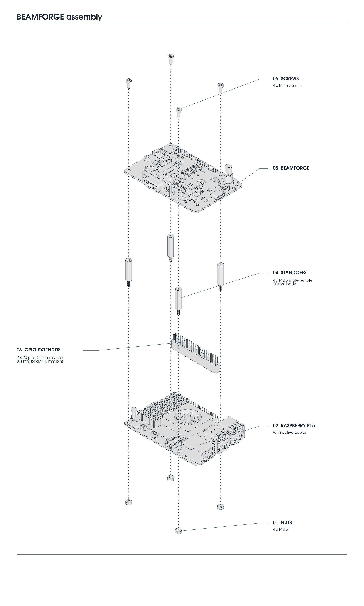

# BeamForge Installation

BeamForge connects a Raspberry Pi running VectorPie to an arcade vector monitor. This guide shows a Raspberry Pi 5 with its active cooler, a GPIO extender, and BeamForge mounted above it.

## Included with BeamForge

| Quantity | Part |
|---|---|
| 1 | Assembled BeamForge board |
| 4 | M2.5 male-female standoffs, **20 mm body**, excluding the threaded stud |
| 4 | M2.5 × 6 mm screws |
| 4 | M2.5 nuts |
| 1 | GPIO stacking extender: **2 × 20 pins, 2.54 mm pitch, 8.4 mm socket body, 6 mm exposed pins** |
| 1 | Short USB-A to USB-C **data cable**, approximately 6 in / 15 cm, for the Pi-to-BeamForge connection |

## You also need

- A Raspberry Pi 5 with the active cooler installed and its fan connected.
- Storage with the [VectorPie image installed](../README.md#download--installation).
- A compatible arcade vector monitor.
- A suitable power source for the Raspberry Pi.

## Assemble BeamForge and the Pi

The drawing below shows how BeamForge mounts above a Raspberry Pi 5 with an active cooler using the included hardware.

The supplied **20 mm standoffs and GPIO extender** are sized for the Pi 5 with active cooler shown above. A different header or cooler can change the required spacing. VectorPie also supports the Pi 4; check physical clearances before using a different stack.

1. Fit the four **20 mm M2.5 standoffs** above the Pi. Their male studs pass down through the Pi's mounting holes. Secure them with the four nuts underneath.
2. Seat the GPIO extender on the Pi's 40-pin header, **socket side down and exposed pins up**. Align both rows and all 40 positions; do not offset it by a row or a pin.
3. Orient BeamForge as drawn, with its underside GPIO socket directly above the extender. Lower it evenly until the header engages and the board rests on all four standoffs.
4. Fit the four **M2.5 × 6 mm screws** through BeamForge into the standoffs. Tighten gently. The boards must remain parallel; do not use the screws to pull an incorrectly seated header into place.
5. Check that BeamForge clears the cooler and fan, and that the fan cable is not trapped.

## Connect USB and power

With the Pi PCB horizontal, **upper** means the USB socket farther from the PCB.

| Connection | Cable / destination |
|---|---|
| Pi **upper blue USB 3** socket → BeamForge **USB-C**, J4 on BeamForge | Included USB-A to USB-C data cable |
| Pi **USB-C power** socket → power source | Suitable Pi power supply |

Connect the included USB data cable even with the GPIO extender installed. Use one Pi power source at a time.

## Cabinet adapters

To simplify connection to an existing cabinet, we offer adapter boards for [Asteroids / Asteroids Deluxe](asteroids-adapter-installation.md) and [Space Duel / Gravitar / Black Widow](space-duel-adapter-installation.md).

## First startup

1. Check GPIO alignment, mounting clearance, the USB data cable, Pi power, and the vector cable before switching on.
2. Boot VectorPie. Open **Settings → DVG → HARDWARE** and confirm that it reports **BEAMFORGE**. A keyboard can be used for initial setup; **Tab** opens Settings.
3. Open **Settings → DVG → SETTINGS...** to configure BeamForge for the connected monitor.

[Back to the VectorPie manual](../README.md)
